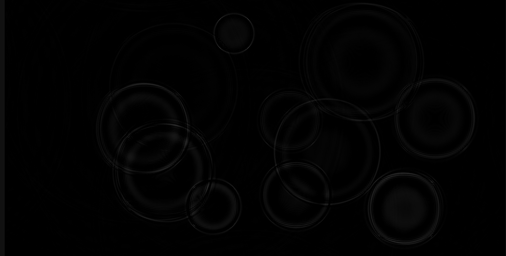
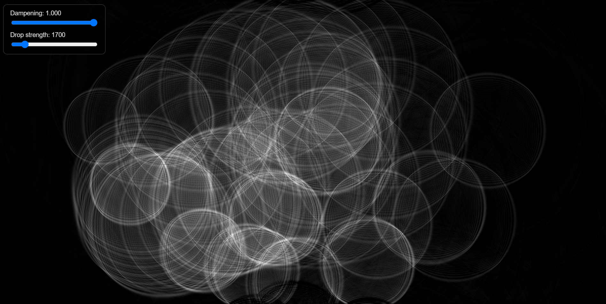

# RIPPLE
water ripple simulation that runs in your browser address bar, uses js to create the simulation. click or drag on the canvas to create ripples.

## WHY IT WORKS?
the simulation needs two grids of numbers, one for the previous frame and one for the frame before that. both are needed because the water has to remember how it was moving, not just where it is.

for every cell, the new height is calculated from two things:
1. smoothing: the average of the four neighbours. this makes the wave spread outwards.

2. velocity: the cells own value from two frames ago, subtracted from the result. that older value is proportional to how fast the water is rising or falling, so subtracting it keeps the wave moving instead of just blurring away.

## DAMPING
without damping, the ripples would never stop. multiplying every cell by a number just below 1 removes a little energy each frame, so the waves fade out naturally. you can change this with the dampening slider. also theres a drop strength slider.

## TO ADD IN THE FUTURE
1. draw it over an image.
2. random raindrop.
3. refraction.
4. shading.

## SOURCES
Algorithm (Hugo Elias, archived page): https://web.archive.org/web/20160418004149/http://freespace.virgin.net/hugo.elias/graphics/x_water.htm

